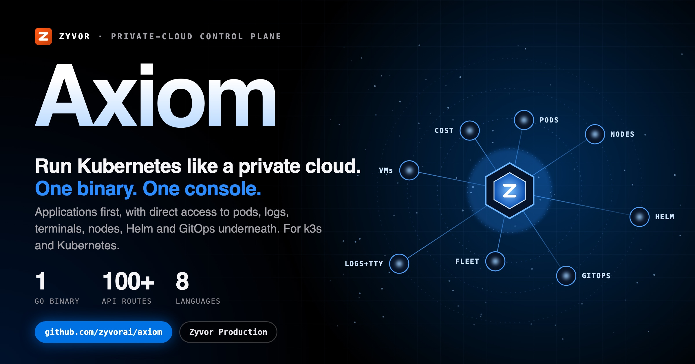
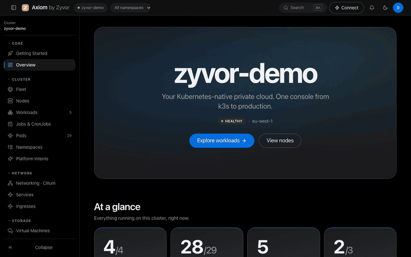
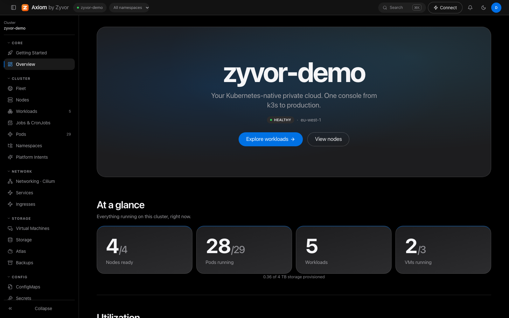
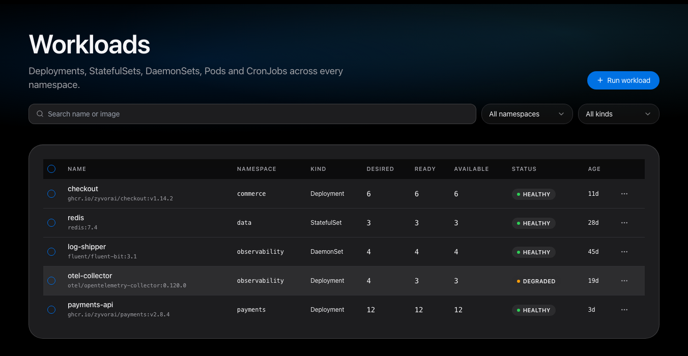
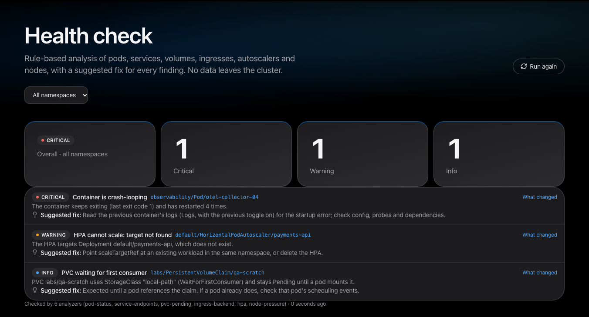
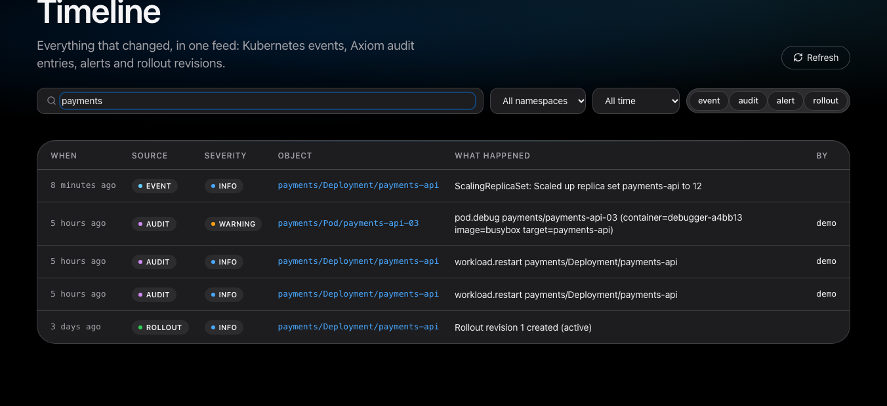
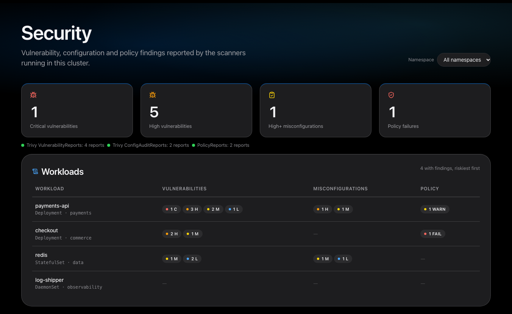
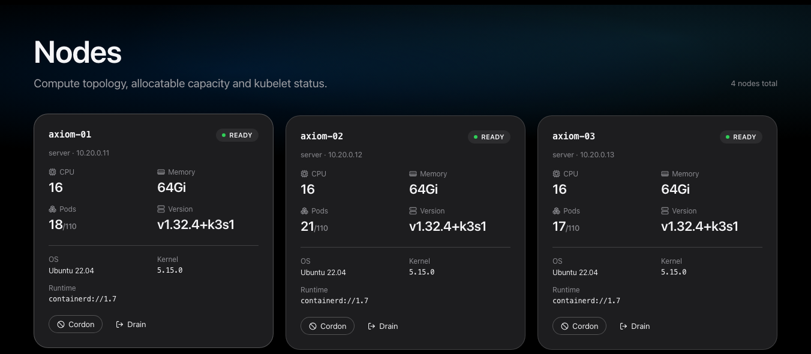
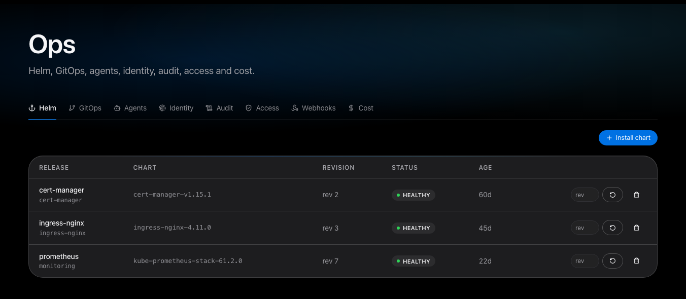

<div align="center">

# Axiom

[](https://github.com/zyvorai/axiom/actions/workflows/ci.yml)
[](LICENSE)
[](CHANGELOG.md)
[](go.mod)
[](frontend)
[](docs/DEPLOYMENT.md)

[](https://zyvor.dev/schedule?utm_source=github&utm_medium=axiom&utm_campaign=readme_hero)
[](#quickstart)



### Run Kubernetes like a private cloud. One binary. One console.

**Private-cloud control plane for k3s and Kubernetes.** Axiom shows applications first, and keeps Pods, logs, an interactive terminal, events, nodes, scaling, restart, stop/start, eviction and drain one click away.

**Apps first** · **One Go binary, UI embedded** · **Real auth: local, OIDC, SAML, LDAP** · **Viewer role enforced server-side** · **8 languages**

</div>

---

## Why Axiom

| When this happens… | Axiom gives you… |
|---|---|
| Your team thinks in apps, not Pods | An application-first Workloads view with start, stop, restart, scale, rollout history and undo |
| A pod will not start | A plain-English "why is this pod not running", built from scheduling conditions, Events and container waiting reasons |
| Something broke and nobody knows what changed | A Timeline of events, audit entries, alerts and rollouts, also a *What changed* tab on every workload |
| You run more than one cluster | Fleet: every cluster's health, latency, nodes, pods and CPU/memory, with one-click switching |
| You need a shell or logs now | Live log tail and a real PTY terminal over WebSocket, with no `kubectl` on the laptop |
| Helm and GitOps live in other tools | Chart install and rollback, plus Argo CD / Flux creation and sync, in the same console |
| Cloud bills are a surprise | Cost by namespace and workload, budgets, rightsizing, and (experimental) real invoice reconciliation |
| Not everyone should be able to change things | `admin` / `operator` / `viewer` roles, namespace-restricted viewers, two-factor sign-in, and an audit log |

Axiom is deliberately small to run: a single Go binary with the React UI embedded, installed by one Helm chart. No database is required.

---

## See it live





<table>
<tr>
<td width="50%"><br><sub><b>Applications</b> — workloads with a full action menu</sub></td>
<td width="50%"><br><sub><b>Health check</b> — findings, each with a suggested fix</sub></td>
</tr>
<tr>
<td><br><sub><b>Timeline</b> — what changed, in one feed</sub></td>
<td><br><sub><b>Security</b> — Trivy and Kyverno results per workload</sub></td>
</tr>
<tr>
<td><br><sub><b>Nodes</b> — capacity, cordon, drain, taints</sub></td>
<td><br><sub><b>Ops → Helm</b> — catalog, install, rollback</sub></td>
</tr>
</table>

---

## What you get

| | |
|---|---|
| **Run** | Deployments, StatefulSets, DaemonSets, CronJobs and Jobs. A *Run workload* wizard (form, natural-language intent, or YAML validate-and-apply), bulk restart/delete, a diff review before any Apply. |
| **Operate** | Pods with exec, logs, evict; Nodes with cordon, uncordon, drain and taints; Autoscaling (HPA, VPA, KEDA); Quotas, Limits and PDBs. |
| **Network** | Services, Ingresses and Gateway API, NetworkPolicy list/create/delete, and a live [PacketWolf](docs/ARCHITECTURE.md) eBPF/Cilium flow panel when configured. |
| **Storage** | PVCs by StorageClass, PersistentVolumes, Backups (VolumeSnapshots and Velero), and the optional Atlas control plane. |
| **Virtual machines** | KubeVirt lifecycle (start, stop, migrate), snapshots, clones, exports, restores. |
| **Understand** | Health check, Timeline, Security reports, a resource graph per workload, an Access review ("who can delete Secrets here?"), and opt-in *Explain with AI* with redacted, previewed payloads. |
| **Ops hub** | Helm, GitOps, Agents, Identity, Audit with CSV export, RBAC, Webhooks, Cost. |
| **Everywhere** | ⌘K command palette, saved views, keyboard shortcuts, notification inbox, light and dark themes, English, Deutsch, Español, Français, Português, Italiano, 日本語 and 简体中文. |

The complete page-by-page list is in [docs/customer/PAGE_INDEX.md](docs/customer/PAGE_INDEX.md).

---

## How it fits together

```text
                  Browser  ·  scripts / CI
                         |  HTTPS  (Basic / OIDC / SAML / LDAP)
                         v
        +------------------------------------------+
        |           zyvor-axiom  (one Go binary)    |
        |  React UI (embedded)  +  /api/v1  (100+)  |
        |  auth · roles · audit · multi-cluster     |
        +--------+-----------------+----------------+
                 |                 |
        client-go (in-cluster      |  optional integrations
        ServiceAccount, or         |  Atlas · PacketWolf · Postgres
        kubeconfig contexts)       |  OIDC · Slack/webhook · Argo/Flux
                 v                 v
          k3s / Kubernetes     your tools
```

The ServiceAccount gets a per-group RBAC allowlist, never a wildcard. Axiom's own RBAC UI can create namespaced Roles but deliberately cannot touch ClusterRoles. Details: [Architecture](docs/ARCHITECTURE.md) · [Security posture](docs/COMPLIANCE.md).

---

## Quickstart

You need a cluster with `kubectl`, and Helm 3. No Go or Node toolchain.

```bash
helm install axiom deploy/helm/axiom \
  --set auth.username=admin \
  --set auth.password='replace-with-a-strong-password'

kubectl -n axiom-system get pods -w
```

Then open `https://<any-node-ip>:30590` (accept the self-signed certificate once) and sign in. Ingress with a real certificate, OIDC/SAML, Atlas and other variations: **[Quickstart](docs/QUICKSTART.md)** · **[Deployment guide](docs/DEPLOYMENT.md)**.

### Try the demo locally

```bash
make build
AXIOM_MODE=demo AXIOM_USERNAME=demo AXIOM_PASSWORD=demo AXIOM_ADDR=:5090 ./bin/zyvor-axiom
```

Open `http://localhost:5090` and sign in with `demo` / `demo`. Demo mode ships three fake clusters so the Fleet switcher has something to show; it needs no Kubernetes.

<details>
<summary><b>Build the production Kubernetes binary</b></summary>

```bash
go mod download -modfile=go.production.mod
./scripts/sync-ui.sh   # builds frontend/ into internal/ui/dist/ (generated, gitignored)
go build -modfile=go.production.mod -tags kubernetes -o bin/zyvor-axiom-kubernetes ./cmd/zyvor-axiom
KUBECONFIG=$HOME/.kube/config AXIOM_MODE=kubernetes ./bin/zyvor-axiom-kubernetes
```

Only the `kubernetes`-tagged build registers the interactive terminal WebSocket and Pod `resources`. Requires Node 20+ for the frontend.
</details>

---

## Workload semantics

Axiom treats lifecycle as Kubernetes does, instead of pretending a Pod is a VM.

| Action | What actually happens |
|---|---|
| **Stop** | Saves replicas in `axiom.zyvor.dev/last-replicas`, then scales to zero |
| **Start** | Restores the saved replica count |
| **Restart** | Patches the Pod template with `axiom.zyvor.dev/restarted-at` |
| **Evict Pod** | Uses the Eviction API, so PDBs are respected |
| **Drain Node** | Skips DaemonSet and `kube-system` Pods, evicts the rest |

---

## Security

- **Roles enforced at the middleware**, before any handler: `viewer` gets `403` on every `POST/PUT/PATCH/DELETE`. Viewers can be restricted to namespaces.
- **SSO**: OIDC and SAML, with group-to-role mapping; LDAP through the same sign-in form.
- **Two-factor (TOTP)** with recovery codes, and sign-out-everywhere per account.
- **Audit log** persisted across restarts.
- **Helm installs run as a Job** under Axiom's own ServiceAccount with no shell interpolation of user input, so a chart cannot exceed Axiom's RBAC.
- **AI is opt-in** and never sees Secret values.

Production checklist and the lab-mode defaults you must change: [Deployment](docs/DEPLOYMENT.md) · Report issues: [SECURITY.md](SECURITY.md).

---

## Testing

| | |
|---|---|
| Unit | `go test ./cmd/... ./internal/...` (demo build) and `go test -modfile=go.production.mod -tags kubernetes ./internal/...` (real provider against fake clientsets) |
| Frontend | `cd frontend && npm run lint` (design, a11y, JS) |
| End to end | `e2e/` Playwright in Chromium, Firefox and WebKit: smoke, walkthroughs, every create/edit/delete/action flow, SSO mock IdPs |

Fake clientsets do not reproduce API-server validation, admission, server-side apply or real drain semantics, and the cloud billing clients are verified only against fixtures. See [docs/GAPS.md](docs/GAPS.md) and [e2e/README.md](e2e/README.md) for what a pass does and does not prove.

---

## Documentation

[Quickstart](docs/QUICKSTART.md) · [Architecture](docs/ARCHITECTURE.md) · [API reference](docs/API.md) · [Deployment](docs/DEPLOYMENT.md) · [Design system](docs/DESIGN-SYSTEM.md) · [Backup and restore](docs/BACKUP-RESTORE.md) · [Compliance](docs/COMPLIANCE.md) · [Roadmap](docs/ROADMAP.md) · [Verification](docs/VERIFICATION.md) · [Changelog](CHANGELOG.md)

```text
cmd/zyvor-axiom/    server entrypoint          frontend/    React UX source (edit here)
internal/api/       HTTP API and realtime      scripts/     dev and deploy helpers
internal/auth/      auth middleware            deploy/      Helm chart and k8s manifests
internal/platform/  demo + Kubernetes providers e2e/        Playwright suites
```

---

## License

Source-available under the **[Zyvor Production License v1.0](LICENSE)**.

- **Free** for evaluation, development, testing, proofs of concept, research, education and all other non-production use.
- **Production use needs a commercial license** from Zyvor AI Labs Private Limited: production clusters, customer workloads, SaaS, managed services, OEM and redistribution. See [SUBSCRIPTION-MODEL](docs/SUBSCRIPTION-MODEL.md) or talk to us at [zyvor.dev](https://zyvor.dev?utm_source=github&utm_medium=axiom&utm_campaign=readme_footer).
